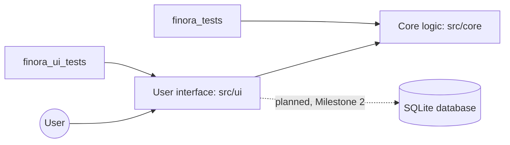
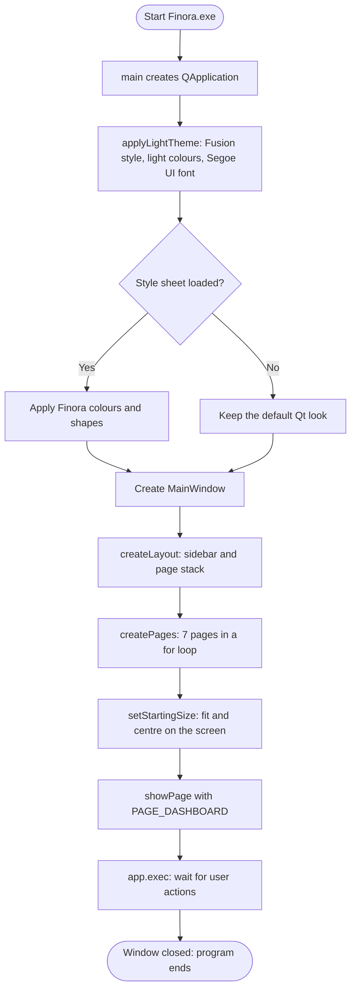
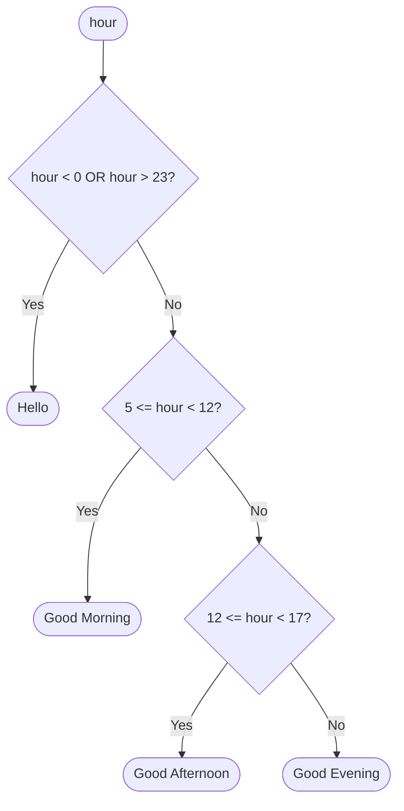

# Finora Design

This document explains how Finora is organised and how its algorithms work. It describes only what exists in the code. Anything not built yet is marked **Planned — Not Yet Implemented**.

Last updated: Milestone 1, 27 October 2026.

## 1. Architecture

Finora is split into layers. Each layer has one job.

| Layer | Folder | Job | Uses Qt? | Status |
|---|---|---|---|---|
| Core logic | `src/core` | Rules and calculations in plain C++ | No | Started: greeting |
| User interface | `src/ui` | Window, sidebar, pages, theme | Yes, Qt Widgets | Started: navigation shell |
| Database | `src/database` | Save and load data with SQLite | Yes, Qt SQL | **Planned — Not Yet Implemented** (Milestone 2) |
| Tests | `tests` | Check the core logic and the window automatically | Core tests no, interface tests yes | Started |



**Why the core has no Qt.** Calculations such as totals, budget percentages and currency conversion will live in `src/core` and use only standard C++ such as `int`, `long long`, `std::string` and `std::vector`. This keeps the logic close to the Programming Fundamentals syllabus, and a small console program can test it directly.

**Why the interface uses classes.** Each part of the screen is one class. `MainWindow` holds everything, `Sidebar` is the navigation bar, `PageHeader` is the title area, and `PlaceholderPage` stands in for pages that are not built yet.

## 2. Program start-up



Pseudocode for `main()` in `src/main.cpp`:

```text
CREATE the Qt application
SET the application name to "Finora" and the version to FINORA_VERSION
CALL applyLightTheme(application)
CREATE the main window
SHOW the main window
RUN the event loop until the window is closed
RETURN the exit code
```

## 3. Page navigation

When the user clicks a sidebar button, three functions run one after another.


Pseudocode for `MainWindow::showPage(pageNumber)`:

```text
IF pageNumber < 0 OR pageNumber >= PAGE_COUNT THEN
    RETURN                      // invalid number: do nothing
END IF
SHOW page number pageNumber in the page stack
HIGHLIGHT sidebar button number pageNumber
```

The buttons and pages share the same numbers, which are defined once as constants in `src/ui/Sidebar.h`: `PAGE_DASHBOARD = 0` up to `PAGE_SETTINGS = 6`, and `PAGE_COUNT = 7`.

## 4. Greeting algorithm

`greetingForHour(int hour)` in `src/core/Greeting.cpp` chooses the dashboard title.

```text
FUNCTION greetingForHour(hour)
    IF hour < 0 OR hour > 23 THEN
        RETURN "Hello"                       // invalid input
    END IF
    IF hour >= 5 AND hour < 12 THEN
        RETURN "Good Morning"
    ELSE IF hour >= 12 AND hour < 17 THEN
        RETURN "Good Afternoon"
    ELSE
        RETURN "Good Evening"                // 17 to 23 and 0 to 4
    END IF
END FUNCTION
```



Boundary tests in `tests/finora_tests.cpp`:

| Input hour | Expected | Why this value |
|---|---|---|
| 4 | Good Evening | last hour before morning |
| 5 | Good Morning | first morning hour |
| 11 | Good Morning | last morning hour |
| 12 | Good Afternoon | first afternoon hour |
| 16 | Good Afternoon | last afternoon hour |
| 17 | Good Evening | first evening hour |
| 0 and 23 | Good Evening | midnight and the last hour |
| -1 and 24 | Hello | invalid input |

## 5. Starting window size

`MainWindow::setStartingSize()` opens the window at 1280 × 800 pixels, but never larger than 90% of the screen area above the taskbar. It then centres the window.

```text
width  = 1280,  height = 800
maxWidth  = screenWidth  * 9 / 10
maxHeight = screenHeight * 9 / 10
IF width  > maxWidth  THEN width  = maxWidth
IF height > maxHeight THEN height = maxHeight
left = screenLeft + (screenWidth  - width)  / 2
top  = screenTop  + (screenHeight - height) / 2
```

Example: a laptop screen of 1366 × 728 above the taskbar gives `maxHeight = 728 * 9 / 10 = 655`, which is integer division. The window opens at 1229 × 655.

## 6. Money precision and rounding rules

**Planned — Not Yet Implemented** (Milestones 3 and 5). These rules were agreed before coding so that every later feature follows them.

1. PKR, USD and EUR all use two decimal places.
2. Each amount is stored as a whole number of the smallest unit, paisa or cents, in a `long long`. Example: PKR 1,200.50 is stored as `120050`.
3. A typed amount with more than two decimals is rejected, not rounded. Zero and negative amounts are rejected. The transaction type, income or expense, gives the direction of the money.
4. Exchange rates are stored to four decimal places. Example: 1 USD = 280.1234 PKR.
5. A conversion rounds only once, to the nearest paisa or cent, and halves round up.
6. Totals are always shown per currency. A converted total is labelled as converted and shows the rate used.

## 7. Database

**Planned — Not Yet Implemented** (Milestone 2). The tables, their columns and the reasons for them will be documented here when the database is built.
