# Finora Design

This document explains how Finora is organised and how its algorithms work. It describes only what exists in the code. Anything not built yet is marked **Planned — Not Yet Implemented**.

Last updated: Milestone 4, Phase 4C, 31 October 2026.

## 1. Architecture

Finora is split into layers. Each layer has one job.

| Layer | Folder | Job | Uses Qt? | Status |
|---|---|---|---|---|
| Core logic | `src/core` | Rules in plain C++: greeting, transaction validation, dates, currencies, reading and writing amounts, search and filters, checked totals per currency, budget rules, password and account rules, the Session, plans and entitlements, the subscription lifecycle, CSV text | No | Done for Milestones 1 to 4C |
| Database | `src/database` | Open the SQLite file, create and safely upgrade tables, backups; transactions, settings, budgets, accounts, subscriptions and payments; the single-copy lock | Yes, Qt SQL | Done for Milestones 2 to 4C |
| Accounts | `src/auth` | Argon2id password hashing (libsodium) and the account rules: sign-up, sign-in, sessions, recovery | Yes, Qt Core | Done in Phase 4B |
| Billing | `src/billing` | The payment gateway interface, the simulated gateway and the subscription lifecycle | Yes, Qt Core | Done in Phase 4C |
| Reports | `src/reports` | The CSV export and the monthly PDF summary | Yes, Qt GUI | Done in Phase 4C |
| User interface | `src/ui` | Windows, sidebar, light and dark theme, the pages, forms, dialogs, reusable components | Yes, Qt Widgets and Qt Svg | Done for Milestones 1 to 4C |
| Tests | `tests` | Check the core, the windows, the database, the accounts and the subscriptions automatically | Core tests no; the others yes | 5 test programs |

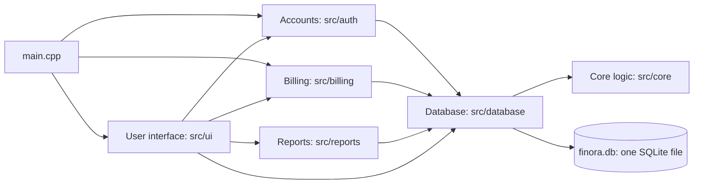

**Why the core has no Qt.** Rules such as "the amount must be above zero" live in `src/core` and use only standard C++: `int`, `long long`, `std::string`, arrays and structures. A small console program can test them directly.

**Why all SQL is in one folder.** Only `src/database` contains SQL: `DatabaseManager` and the store classes `BudgetStore`, `UserStore` and `SubscriptionStore`. In `CMakeLists.txt`, Qt SQL is linked to `finora_database` as `PRIVATE`, so the user interface, the account, billing and report code cannot even see the SQL classes.

## 2. Program start-up

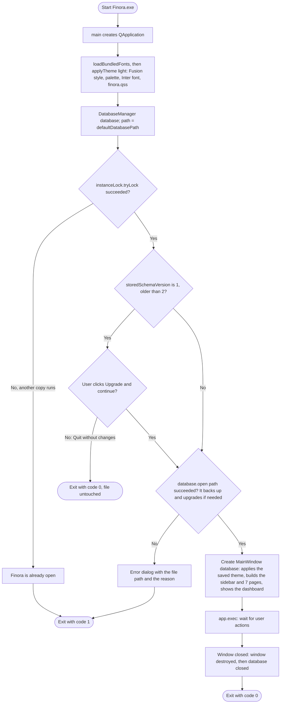

Pseudocode for `main()` in `src/main.cpp`:

```text
CREATE the Qt application and set its name and version
CALL loadBundledFonts() and applyTheme(application, THEME_LIGHT)
path = DatabaseManager::defaultDatabasePath()
IF NOT instanceLock.tryLock() THEN         // finora.lock next to finora.db
    SHOW "already open" or the error, RETURN 1
END IF
version = DatabaseManager::storedSchemaVersion(path)   // read-only peek
IF version is 1 (older than CURRENT_SCHEMA_VERSION) THEN
    IF the user does NOT click "Upgrade and continue" THEN
        RETURN 0                     // nothing was changed
    END IF
END IF
CREATE a DatabaseManager called database
IF NOT database.open(path) THEN
    SHOW an error dialog with path and database.lastError()
    RETURN 1                         // Finora never runs without saving
END IF
CREATE the main window, giving it the database, and SHOW it
RUN the event loop until the window is closed
RETURN the exit code                 // database closes automatically (RAII)
```

`database` is declared before `window`. C++ destroys local objects in the reverse order, so the window is destroyed first and the database is closed last.

## 3. Page navigation

When the user clicks a sidebar button, three functions run one after another.

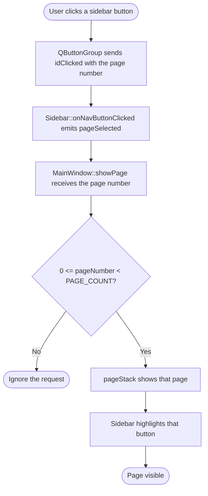

```text
IF pageNumber < 0 OR pageNumber >= PAGE_COUNT THEN
    RETURN                      // invalid number: do nothing
END IF
SHOW page number pageNumber in the page stack
HIGHLIGHT sidebar button number pageNumber
```

## 4. Greeting algorithm

`greetingForHour(int hour)` in `src/core/Greeting.cpp` chooses the dashboard title.

```text
FUNCTION greetingForHour(hour)
    IF hour < 0 OR hour > 23 THEN RETURN "Hello"          // invalid input
    IF hour >= 5 AND hour < 12 THEN RETURN "Good Morning"
    ELSE IF hour >= 12 AND hour < 17 THEN RETURN "Good Afternoon"
    ELSE RETURN "Good Evening"                             // 17 to 23 and 0 to 4
END FUNCTION
```


## 5. Starting window size

`MainWindow::setStartingSize()` opens the window at 1280 × 800 pixels, but never larger than 90% of the screen area above the taskbar, and centres it.

```text
width = 1280, height = 800
maxWidth  = screenWidth  * 9 / 10
maxHeight = screenHeight * 9 / 10
IF width  > maxWidth  THEN width  = maxWidth
IF height > maxHeight THEN height = maxHeight
left = screenLeft + (screenWidth  - width)  / 2
top  = screenTop  + (screenHeight - height) / 2
```

Example: a screen area of 1366 × 728 gives `maxHeight = 728 * 9 / 10 = 655` with integer division, so the window opens at 1229 × 655.

## 6. Money rules

**Implemented in Milestone 2:**

1. PKR, USD and EUR all use two decimal places. The `decimal_places` column of the `currencies` table records this.
2. Each amount is stored as a whole number of the smallest unit, paisa or cents. In C++ it is a `long long`; in SQLite it is an `INTEGER`, which is also 64-bit. Example: PKR 1,200.50 is stored as `120050`. Whole numbers add up exactly, unlike `double`.
3. One transaction must have an amount above 0 and at most `MAX_AMOUNT_MINOR = 999,999,999,999` minor units, which is 9,999,999,999.99. This is a validation rule for a single transaction. That maximum fits easily in a signed 64-bit integer, whose limit is 9,223,372,036,854,775,807.
4. Zero and negative amounts are rejected. The transaction type, income or expense, gives the direction of the money.
5. Currency codes are exact, upper-case ISO codes. `"pkr"` is rejected.

**Rule for future totals — Planned — Not Yet Implemented (Milestone 4).** The single-transaction limit does not make totals safe. Adding enough amounts together could pass the 64-bit limit and silently wrap around to a wrong, even negative, number. Every total must therefore use checked addition:

```text
FUNCTION addChecked(total, amount)
    IF amount > LONG_LONG_MAX - total THEN
        REPORT "Total is too large"          // never overflow silently
    ELSE
        total = total + amount
    END IF
END FUNCTION
```

**Implemented in Milestone 3:**

6. A typed amount with more than two decimals is rejected, not rounded. `parseAmount()` in `src/core/Money.cpp` reads the text digit by digit without ever using a `double`; see section 9.2.

**Planned — Not Yet Implemented:**

7. Exchange rates will be stored to four decimal places, and a conversion will round once to the nearest paisa or cent, with halves rounding up (Milestone 5).
8. Totals will always be shown per currency. A converted total will be labelled as converted and show the rate used (Milestones 4 and 5).

## 7. Database

### 7.1 Location

| | |
|---|---|
| File | `%LOCALAPPDATA%\Finora\finora.db` |
| Full form | `C:\Users\<user name>\AppData\Local\Finora\finora.db` |
| Chosen by | `DatabaseManager::defaultDatabasePath()`, using Qt's `QStandardPaths::AppLocalDataLocation` and the application name "Finora" |
| Created | Automatically at the first start, folder and file |

The file is not in the program folder, because programs installed under `C:\Program Files` cannot write there, and it is not in the source folder, because Git must never upload personal data. `.gitignore` already ignores `*.db` files.

### 7.2 Schema version 1

**Table `currencies`:** the currencies Finora supports. It is filled at creation from the `SUPPORTED_CURRENCIES` array in `src/core/Transaction.h`.

| Column | Type and rule | Purpose |
|---|---|---|
| `code` | `TEXT PRIMARY KEY`, exactly 3 characters | ISO code: PKR, USD, EUR. The primary key makes every code unique |
| `name` | `TEXT NOT NULL` | Pakistani Rupee, US Dollar, Euro |
| `symbol` | `TEXT NOT NULL` | Rs, $, € |
| `decimal_places` | `INTEGER NOT NULL`, 0 to 3 | Digits after the decimal point: 2 for all three |

**Table `transactions`:** one row per income or expense.

| Column | Type and rule | Purpose |
|---|---|---|
| `id` | `INTEGER PRIMARY KEY AUTOINCREMENT` | Unique record number. AUTOINCREMENT means a number is never reused, even after a record is deleted |
| `type` | `TEXT NOT NULL`, `'income'` or `'expense'` | Direction of the money |
| `amount_minor` | `INTEGER NOT NULL`, 1 to 999999999999 | Amount in paisa or cents |
| `currency_code` | `TEXT NOT NULL REFERENCES currencies (code)` | Foreign key: the currency must exist in `currencies` |
| `category` | `TEXT NOT NULL`, not blank | For example Food or Salary |
| `description` | `TEXT NOT NULL DEFAULT ''` | Optional note |
| `transaction_date` | `TEXT NOT NULL`, must be a real date | ISO format `YYYY-MM-DD`, which sorts correctly as text and is understood by SQLite's date functions |

**Budgets** are not in version 1. They are added by schema version 2, described in section 10.2.

### 7.3 Two lines of defence

1. **C++ validation.** `validateTransaction()` in `src/core/Transaction.cpp` checks every field before any SQL runs, and gives a clear message such as "Amount must be greater than zero."
2. **SQLite rules.** `CHECK` constraints and the `FOREIGN KEY` repeat the important rules inside the database, so even SQL typed by hand cannot store a zero amount, an unknown currency or a date like 2026-02-30. SQLite enforces foreign keys only after `PRAGMA foreign_keys = ON`, which `enableForeignKeys()` runs at every open and then checks.

### 7.4 Schema versioning

SQLite keeps a whole number called `user_version` inside every database file, for the program's own use. Finora uses it as the schema version. The constant `CURRENT_SCHEMA_VERSION` in `DatabaseManager.h` is 2 since Phase 4A.

| `user_version` in the file | Meaning | What `upgradeSchema()` does |
|---|---|---|
| 0 | New, empty file | Creates the version 1 tables and currencies, then upgrades them to version 2, all inside one database transaction. No backup is needed: there are no records yet |
| 1 | A file from Milestone 2 or 3 | Saves and checks a backup, then upgrades to version 2 inside one transaction (section 10.3) |
| 2 | Up to date | Nothing |
| 3 or more | Made by a newer Finora | Refuses to open and leaves the file unchanged |

Inside the transaction, either every step is saved by `commit()`, or `rollback()` undoes all of them, so a half-created database cannot exist. The statements also use `CREATE TABLE IF NOT EXISTS` and `INSERT OR IGNORE`, so repeating them can never create duplicates. Phase 4A added the next step, "if the version is below 2, upgrade to version 2", described in section 10.3.

### 7.5 Opening the database

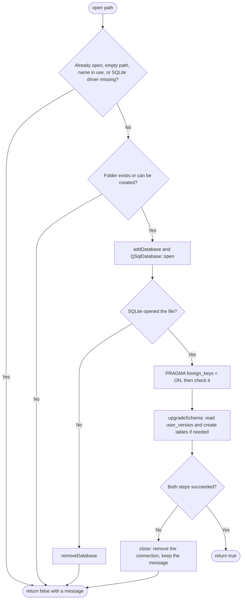

### 7.6 Connection and query lifetime (RAII)

- One `DatabaseManager` object owns one named Qt SQL connection. `open()` creates it. `close()` and the destructor remove it, so the connection can never outlive its owner. This idea is called RAII: resource acquisition is initialisation.
- Copying a `DatabaseManager` is disabled with `= delete`. A copy would share the connection name, and destroying the copy would close the original's connection.
- `close()` removes a connection only if this object opened it. A second object that was refused a duplicate name therefore cannot disturb the first.
- The class never stores `QSqlDatabase` or `QSqlQuery` objects as members. Each function creates them as local variables, which are destroyed when the function returns. In `open()` and `close()`, extra braces `{ ... }` end the life of the handle before `QSqlDatabase::removeDatabase()` runs. Qt prints the warning "connection is still in use" if this order is wrong. The database tests print no such warning.

### 7.7 Saving and reading a transaction

`addTransaction(Transaction &transaction)`:

```text
IF the database is not open THEN fail "The database is not open."
problem = validateTransaction(transaction)
IF problem is not empty THEN fail with problem          // no SQL runs
PREPARE "INSERT INTO transactions (...) VALUES (:type, :amount, ...)"
BIND each placeholder to a field of the transaction
EXECUTE; IF it fails THEN fail "Could not save the transaction: <SQLite message>"
transaction.id = the id SQLite gave the new row
RETURN true
```

`findTransactionById(int id, Transaction &result)` checks `id > 0`, runs a prepared `SELECT ... WHERE id = :id`, and returns "No transaction with id N was found." when there is no such row. Otherwise it copies each column into `result`.

**Prepared statements.** The SQL text contains only placeholders such as `:description`, and the values are sent separately. A description like `Ali's café; DROP TABLE transactions; --` is therefore stored as plain text and can never change the command. This prevents SQL injection, and the database tests prove it.

### 7.8 Inspecting, backing up and resetting

- **Open the folder:** press Win + R, type `%LOCALAPPDATA%\Finora` and press Enter.
- **Look inside:** close Finora and open `finora.db` in any SQLite viewer, such as the free DB Browser for SQLite.
- **Back up:** close Finora, then copy `finora.db` to a safe place.
- **Restore:** close Finora, then copy the backup over `finora.db`.
- **Start empty:** close Finora and delete `finora.db`. A new empty database is created at the next start. This permanently deletes all records.

### 7.9 Two copies of Finora at the same time

Before the single-instance guard below existed, nothing stopped a second copy of Finora from opening the same database. SQLite lets several programs read the file, but only one can write at a time. A program that wants to write while another holds the write lock must wait, and Qt's SQLite driver gives up after a timeout.

Measured on 28 October 2026 with temporary databases and Finora's real `DatabaseManager`:

| Test | Result |
|---|---|
| Two programs each saving 300 transactions at the same moment | 591 saved and 9 rejected with "database is locked"; saves slowed to several seconds each; integrity check ok |
| One save while another program held the write lock for 3 seconds | Waited about 2.3 seconds, then saved |
| One save while another program held the write lock for 8 seconds | Rejected after about 6 seconds with "database is locked" |
| Two programs creating the same new database at the same moment, 20 times | No failures |

A rejected save is not stored: `addTransaction` returns `false` and `lastError()` holds the reason. No test damaged a database, but these tests do not prove that every way of using two copies is safe.

**Single-instance guard (done, first task of Milestone 3).** `src/database/InstanceLock.h/.cpp` wraps Qt's `QLockFile`. Before opening the database, `main()` locks a file named `finora.lock` in the same folder as `finora.db`:

```text
lock = InstanceLock(folder of finora.db + "/finora.lock")
IF lock.tryLock() fails THEN
    IF another copy holds it THEN show "Finora is already open"
    ELSE show the database error dialog with the reason
    EXIT with code 1
open the database, show the window ...
```

- `tryLock(0)` tries once and does not wait, so a second copy closes at once instead of hanging.
- `setStaleLockTime(0)` switches off Qt's default rule that a lock older than 30 seconds is abandoned. Without it, a second copy started 30 seconds after the first would take the lock away from a Finora that is still open.
- A lock left behind by a crash is still taken over, because `QLockFile` writes the program's process number into the file and checks whether that program is still running.
- `instanceLock` is declared before `database` in `main()`, so C++ destroys it after the database is closed: the lock is never released while the database is still open (RAII).
- The data folder is per Windows user, so the guard stops two copies for the same user. Two different users have separate databases and do not block each other.

SQLite's journal mode stays at its default, and no retry framework is added. `finora_db_tests` checks the guard: a second lock on the same file is refused with "already running", the file disappears when the first lock is released, a lock from a program that is no longer running is taken over, and a lock file that cannot be created is reported as an error, not as "already running".

## 8. Validation algorithms

All in `src/core/Transaction.cpp`.

**Leap years.** `isLeapYear(year)`:

```text
IF year % 400 == 0 THEN RETURN true      // 2000 was a leap year
IF year % 100 == 0 THEN RETURN false     // 1900 and 2100 are not
RETURN year % 4 == 0                     // 2024 is, 2026 is not
```

**Days in a month.** `daysInMonth(year, month)` uses a `switch`: months 1, 3, 5, 7, 8, 10 and 12 have 31 days; 4, 6, 9 and 11 have 30; February has 29 in a leap year and 28 otherwise; any other number returns 0.

**Real calendar dates.** `isValidIsoDate(text)`:

```text
IF length is not 10 OR text[4] is not '-' OR text[7] is not '-' THEN RETURN false
FOR each other position: IF the character is not '0'..'9' THEN RETURN false
year = digits 0-3, month = digits 5-6, day = digits 8-9      // each digit: character - '0'
IF year < 1900 OR year > 2100 THEN RETURN false              // catches typing mistakes
IF month < 1 OR month > 12 THEN RETURN false
IF day < 1 OR day > daysInMonth(year, month) THEN RETURN false
RETURN true
```

Example: `"2026-02-29"` passes the shape and digit checks, gives year 2026, month 2 and day 29. `daysInMonth(2026, 2)` is 28 because 2026 is not a leap year, and 29 > 28, so the date is rejected.

**Whole transaction.** `validateTransaction()` checks, in this order: type, amount above 0, amount at most the maximum, supported currency, non-blank category, real date. It returns the message for the first problem, or an empty string when everything is valid.

## 9. Transactions page (Milestone 3)

### 9.1 Who does what

| Part | File | Job |
|---|---|---|
| `TransactionsPage` | `src/ui/TransactionsPage.h/.cpp` | The page: table, search box, filters, Edit / Delete / Add buttons, messages |
| `TransactionDialog` | `src/ui/TransactionDialog.h/.cpp` | The pop-up form for adding or editing one transaction |
| `parseAmount`, `formatAmount`, `formatMoney` | `src/core/Money.h/.cpp` | Read "1,200.50" as 120050; write 120050 as "1,200.50" |
| `TransactionFilter`, `filterTransactions`, `distinctCategories` | `src/core/TransactionFilter.h/.cpp` | Search and filters with plain loops over a `std::vector` |
| `loadTransactions`, `updateTransaction`, `deleteTransaction` | `src/database/DatabaseManager.cpp` | The SQL: SELECT all rows, UPDATE one row, DELETE one row |

`main()` creates the only `DatabaseManager`. `MainWindow` receives it as a reference and passes it to `TransactionsPage`, which keeps the reference as a member. The page *uses* the database but does not *own* it, so it never opens or closes it.

### 9.2 Reading a typed amount: `parseAmount`

```text
FUNCTION parseAmount(text, amountMinor)
    text = text without spaces at both ends
    IF text is empty THEN RETURN "Please enter an amount."
    IF text starts with '-' THEN RETURN "Amount must be greater than zero."
    whole = 0, fraction = 0, fractionDigits = 0, seenPoint = false
    FOR each character c of text
        IF c is a digit THEN
            IF seenPoint THEN
                fractionDigits = fractionDigits + 1
                IF fractionDigits > 2 THEN RETURN "Use at most two digits after the decimal point."
                fraction = fraction * 10 + digit
            ELSE
                whole = whole * 10 + digit
                IF whole > 9,999,999,999 THEN RETURN "Amount is too large..."
        ELSE IF c is '.' THEN
            IF seenPoint THEN RETURN "An amount can have only one decimal point."
            seenPoint = true
        ELSE IF c is ',' THEN
            IF it is not between two digits of the whole number THEN RETURN "Commas may only separate digits..."
        ELSE
            RETURN "An amount may contain only digits, commas and one decimal point."
    IF exactly one digit came after the point THEN fraction = fraction * 10     // "0.5" is 50 paisa
    result = whole * 100 + fraction
    IF result <= 0 THEN RETURN "Amount must be greater than zero."
    amountMinor = result
    RETURN ""                                                                 // success
END FUNCTION
```

Example: "1,200.50". The digits 1, 2, 0, 0 give `whole = 1200`; the comma sits between two digits, so it is allowed and ignored; after the point, 5 and 0 give `fraction = 50`. The result is `1200 * 100 + 50 = 120050`. No `double` is used anywhere, so there is no rounding error. Both "1,200" and the Pakistani form "1,20,000" are accepted. The form shows "Will be saved as PKR 1,200.50" while the user types, so any doubt about commas is visible before saving.

`formatAmount` goes the other way: it splits 120050 into 1200 and 50, then walks the digits of 1200 from the right and puts a comma after every third digit, giving "1,200.50".

### 9.3 Search and filters

The page keeps every transaction loaded from SQLite in a `std::vector<Transaction>`. Each change in the filter bar builds a `TransactionFilter` and calls `filterTransactions`, which loops over the vector and keeps the transactions for which `matchesFilter` is true. Empty filter fields mean "any".

```text
FUNCTION matchesFilter(t, filter)
    IF filter.type is set AND t.type is different THEN RETURN false
    IF filter.currency is set AND t.currency is different THEN RETURN false
    IF filter.category is set AND t.category is different THEN RETURN false
    IF filter.fromDate is set AND t.date < filter.fromDate THEN RETURN false
    IF filter.toDate is set AND t.date > filter.toDate THEN RETURN false
    IF filter.searchText is set AND it is in neither t.description nor t.category THEN RETURN false
    RETURN true
END FUNCTION
```

- Dates are compared as text. This works because YYYY-MM-DD puts the year first: "2026-09-30" < "2026-10-01".
- The search ignores upper and lower case: both texts are changed to lower case with `toLowerText` first.
- "This month", "Last month" and "This year" are turned into a first and a last date with `QDate` in `TransactionsPage::currentFilter`, using a `switch`.
- **Why filter in C++ and not in SQL?** One person's records fit easily in memory, the logic is plain loops and `if` statements that the core tests check without a database, and the SQL stays simple. For very large data sets, a `WHERE` clause in SQL would be better.

### 9.4 From the screen to SQLite and back

**Adding a transaction:**

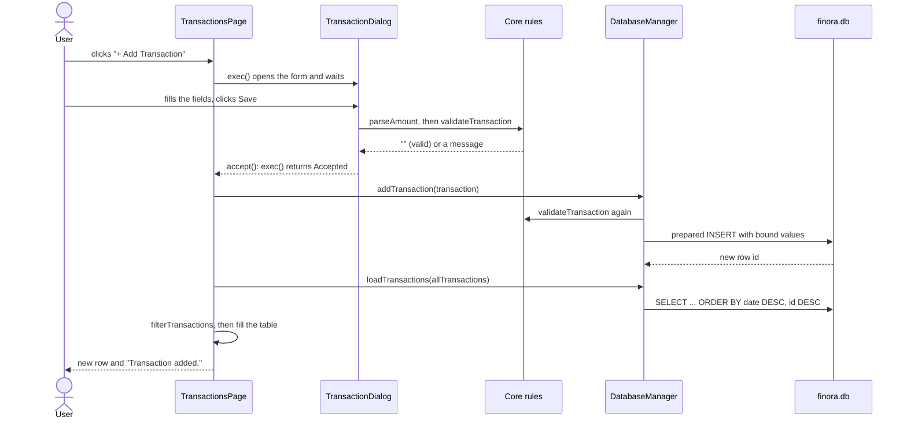

**Editing** works the same way. The page finds the selected row's id, which each row keeps hidden in its first cell with `Qt::UserRole`. It copies that transaction from the vector into `TransactionDialog(existing)`, then calls `updateTransaction`, which runs a prepared `UPDATE ... WHERE id = :id`.

**Deleting** asks first with `QMessageBox::question`, with "No" as the default. Only "Yes" calls `deleteTransaction`, which runs a prepared `DELETE ... WHERE id = :id`. If no row had that id, `numRowsAffected()` is 0, and the user gets "No transaction with id N was found." instead of a false success.

After every add, edit or delete, the page reloads all rows from SQLite instead of changing the table by hand, so the screen always shows exactly what is stored.

### 9.5 Messages and errors

| Situation | What the user sees |
|---|---|
| Wrong input in the form | A red line in the form, for example "Use at most two digits after the decimal point."; the form stays open |
| Saved, updated or deleted | A green banner, for example "Transaction added.", hidden after 4 seconds by a single-shot `QTimer` |
| Database refuses or fails | A warning box: "Could not save the transaction. Reason: ..." The table does not change |
| Nothing saved yet | "No transactions yet. Click "Add Transaction" to record your first income or expense." |
| Filters hide every row | "No transactions match these filters." |

### 9.6 Why this design

- **Edit and Delete act on the selected row.** One Edit and one Delete button are simpler to build and explain than a pair of buttons inside every row. Double-clicking a row also opens it for editing.
- **The form validates before closing.** The page only ever receives a valid transaction, and `DatabaseManager` checks again, so data is protected even if code calls it directly.
- **No schema change in Milestone 3.** The Milestone 2 tables already had every column the page needs, so Milestone 3 kept schema version 1. Version 2 came with budgets in Phase 4A.

## 10. Milestone 4, Phase 4A: design system, schema version 2, dashboard and budgets

### 10.1 Who does what

| Part | Layer | Job |
|---|---|---|
| `Totals.h/.cpp` | core | Checked addition; totals per currency; money flow per month; spending per category; the chart scale |
| `Budget.h/.cpp` | core | The `Budget` structure, the `BudgetStatus` enum and the 80% / 100% / over rules |
| `DatabaseManager` | database | New: `storedSchemaVersion`, the backup, `upgradeToVersion2`, settings, the audit history |
| `BudgetStore` | database | All budget SQL: add, load, update, delete, refuse duplicates |
| `Page` | ui | Base class of every page, with the virtual function `refresh()` |
| `DashboardPage`, `BudgetsPage`, `SettingsPage` | ui | The three new pages |
| `BudgetDialog` | ui | The New / Edit Budget form |
| `WalletCard`, `MoneyFlowChart`, `ProgressRing`, `MonthSwitcher`, `Toast` | ui/components | Reusable pieces used by several pages |
| `Theme` | ui | Colour tokens of both themes, fonts, the style sheet template, coloured icons, reduce motion |

The rule from section 1 still holds: the pages contain no SQL and no money arithmetic. They call `BudgetStore` and `DatabaseManager` for data, and `Totals` and `Budget` for every number they show.

### 10.2 Schema version 2

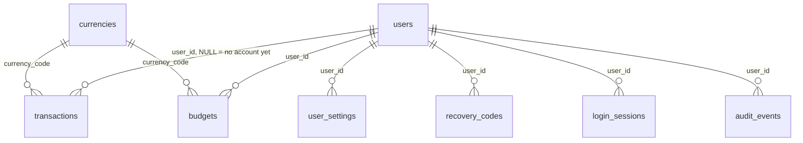

| Table | New or changed | Purpose |
|---|---|---|
| `transactions` | Rebuilt | Same columns as version 1, plus `user_id` (the owner; NULL for records made before accounts existed), `uuid` (32 random hex digits, the same on every computer, for a future cloud sync), `created_at` and `updated_at` (UTC). Index `transactions_by_owner_and_date` on `(user_id, transaction_date)` |
| `budgets` | New | `category`, `currency_code`, `limit_minor` (1 to 999,999,999,999), `user_id`, times. A UNIQUE index on `(ifnull(user_id, 0), lower(category), currency_code)` allows one budget per category and currency |
| `app_settings` | New | Key and value, for this Finora installation: `theme` (`light` or `dark`) and `reduced_motion` (`0` or `1`) |
| `users` | New, used from Phase 4B | Email (unique, case-insensitive), display name, `password_hash` (a one-way Argon2id hash that contains its own salt and settings), failed sign-in count, `locked_until`, times |
| `user_settings` | New, used from Phase 4B | Key and value per user |
| `recovery_codes` | New, used from Phase 4B | `code_hash` only, never the code itself; `used_at` makes each code single-use |
| `login_sessions` | New, used from Phase 4B | Start, last activity, expiry and end of each sign-in |
| `audit_events` | New | A history of important events. Phase 4A writes `database_upgraded` with the name of the backup |

**Why the account tables already exist.** The rebuilt `transactions` table refers to `users`, and a foreign key needs its table. Creating every Milestone 4 table in one upgrade means the user's records are copied once, not twice. The sign-in screens that use these tables are Phase 4B. **Planned — Not Yet Implemented.**

**Records without an owner.** After the upgrade, every existing transaction has `user_id = NULL`. Phase 4B will ask the first person who signs up whether these records should move into their account; Finora never moves them silently.

### 10.3 The safe upgrade from version 1 to version 2

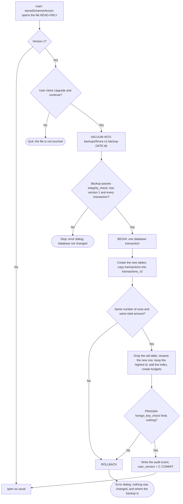

Pseudocode of `upgradeSchema()` in `src/database/DatabaseManager.cpp`:

```text
version = PRAGMA user_version
IF version > 2 THEN refuse ("made by a newer Finora")
IF version == 2 THEN RETURN true
IF version >= 1 THEN                         // the file holds the user's records
    IF NOT backupBeforeUpgrade(version) THEN RETURN false   // nothing changed yet
BEGIN TRANSACTION
ok = true
IF version < 1 THEN ok = createVersion1Tables()
IF ok AND version < 2 THEN ok = upgradeToVersion2()
IF ok THEN ok = checkForeignKeys()
IF ok AND version >= 1 THEN ok = recordAuditEvent("database_upgraded", backup file name)
IF ok THEN ok = run "PRAGMA user_version = 2"
IF NOT ok THEN ROLLBACK, RETURN false        // the message says where the backup is
COMMIT
```

Four details make the upgrade safe:

1. **Backup first, outside the transaction.** `VACUUM INTO` writes a complete, consistent copy. A second, read-only connection then checks it. The upgrade starts only if the copy is good.
2. **One transaction.** Creating, copying, dropping and renaming all happen between `BEGIN` and `COMMIT`. SQLite's rollback journal restores every page on `ROLLBACK`, so a failed upgrade leaves the file byte-for-byte as it was. The tests compare the bytes.
3. **Prove the copy.** The number of rows and the sum of `amount_minor` are read before and after copying. Any difference stops the upgrade.
4. **Ids are never reused.** `AUTOINCREMENT` promises that an id is never given out twice, even after a delete. The highest id ever used is read from `sqlite_sequence` before the copy and written back after the rename.

How it is tested in `finora_db_tests`:

| Test | Result |
|---|---|
| A real version 1 file with 3 transactions and one deleted id | Upgraded: same ids and values, 3 different `uuid`s, `user_id` NULL, the next new id is 5 (not the deleted 4), integrity "ok", no broken foreign keys, one audit event, and a version 1 backup with 3 transactions |
| Deliberate failure 1: a transaction pointing to currency `GBP` | Fails while copying; the file is byte-for-byte unchanged and still version 1; the backup is kept |
| Deliberate failure 2: a table named `budgets` already exists | Fails after the rebuild; rollback restores the original table; the file is byte-for-byte unchanged |
| A version 1 file in which every transaction was deleted | Upgraded; the next new id is still 5, because the highest id ever used is written back even when no row was copied |
| A brand-new file | Created directly at version 2; no backup is needed |

### 10.4 Checked totals and "never mix currencies"

`addChecked(total, amount)` in `src/core/Totals.cpp`:

```text
IF total < 0 OR amount < 0 THEN RETURN false
IF amount > LLONG_MAX - total THEN RETURN false     // total + amount would overflow
total = total + amount
RETURN true
```

`summarizeByCurrency(transactions, month)`:

```text
summaries = one empty summary for PKR, USD and EUR (from SUPPORTED_CURRENCIES)
FOR each transaction
    find the summary with the SAME currency code; if none, SKIP it   // never added to another currency
    count it
    IF income THEN addChecked(total income); IF in the month THEN addChecked(month income)
    ELSE           addChecked(total expense); IF in the month THEN addChecked(month expense)
    IF any addition failed THEN mark the summary as overflow
balance = total income - total expense     // both 0 or more, so this cannot overflow
```

A wallet card that is marked as overflow shows "Too large to show" instead of a wrong number. One transaction can be at most 9,999,999,999.99, so a real overflow needs millions of the largest possible transactions; the tests force it with two huge amounts.

### 10.5 Budget rules

`budgetStatusFor(spent, limit)` in `src/core/Budget.cpp`:

```text
IF spent > limit THEN RETURN BUDGET_OVER               // "Over budget"
IF spent == limit THEN RETURN BUDGET_REACHED           // "Limit reached": nothing left
IF 5 * spent >= 4 * limit THEN RETURN BUDGET_WARNING   // "Nearing limit": 80% or more
RETURN BUDGET_ON_TRACK                                 // "On track"
```

`5 x spent >= 4 x limit` is the same as `spent / limit >= 0.8`, but uses only whole numbers, so there is no rounding. At that point `spent < limit <= 10^12`, so `5 x spent` cannot overflow.

| Spent of a 10,000 limit | Status | Percent shown |
|---|---|---|
| 7,999 | On track | 79% (rounded down) |
| 8,000 | Nearing limit | 80% |
| 9,999 | Nearing limit | 99% |
| 10,000 | Limit reached | 100% |
| 10,001 | Over budget | 100%, and "Over by 0.01" |

`budgetProgressFor(budget, transactions, month)` adds up, with `addChecked`, only the expenses that have the budget's currency, the same category (upper and lower case ignored) and a date in the chosen month. `remaining = limit - spent` is negative when over budget. A budget repeats every month, so choosing another month in the month switcher shows that month's spending against the same limit.

### 10.6 The dashboard: from SQLite to the screen

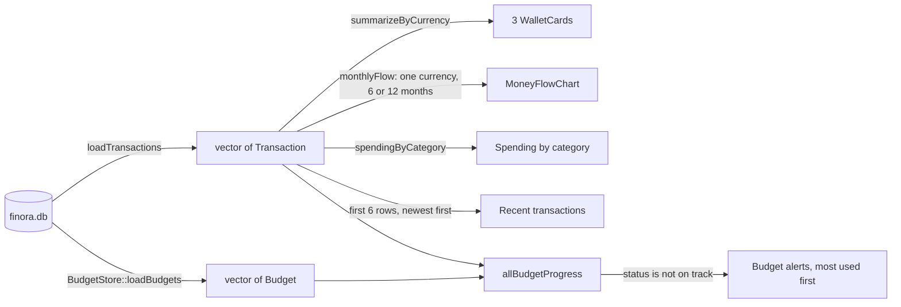

`DashboardPage::refresh()` loads both lists again and redraws every card. `MainWindow` calls it every time the dashboard is shown, so a transaction added on another page is always included. The month switcher changes the month used by the wallet cards, the chart, the alerts and the spending card. The chart's PKR / USD / EUR switch also chooses the currency of the spending card, because amounts in different currencies are never added together.

### 10.7 Drawing the chart and the progress ring

`MoneyFlowChart` and `ProgressRing` override the virtual function `paintEvent()` and draw with `QPainter`. Qt calls `paintEvent()` whenever the widget must be drawn, for example after `update()`.

```text
MoneyFlowChart::paintEvent:
    largest = the biggest income or spending of all months
    top = chartScaleMaximum(largest)       // a round number in 4 equal steps: 0, 30k, 60k, 90k, 120k
    draw 5 grid lines with their labels (formatCompactAmount)
    slot width = plot width / number of months
    FOR each month i
        IF i is highlighted THEN draw a pale violet band behind it
        draw the income bar (teal) left of the slot centre and the spending bar (rose) right of it
            height = plot height x value / top x growth    // growth goes 0 -> 1 while the bars grow in
        write the month name under the slot
    IF a month is highlighted THEN draw the bubble: month, income, spent, net
    IF the chart has the keyboard focus THEN draw a focus ring
```

Moving the mouse over a month, or pressing Left, Right, Home or End, highlights it. The same amounts appear as a sentence under the chart and in the chart's accessible description, so nobody has to read values from bar heights. `ProgressRing` draws a grey circle and a coloured arc whose length is the percentage (at most a full circle), with the percentage written in the middle. Both grow in with a `QVariantAnimation`, which is skipped when "Reduce motion" is on.

### 10.8 The design system

**Colour tokens.** `ThemeColors` in `src/ui/Theme.h` names every colour by its job. Both themes have the same names; only the values differ.

| Token | Light | Dark | Used for |
|---|---|---|---|
| `canvas` | `#F5F3FC` | `#0F0C1D` | Window background |
| `surface` | `#FFFFFF` | `#181430` | Cards, sidebar, dialogs |
| `text` / `textMuted` | `#17132E` / `#625C7E` | `#F2EFFC` / `#ABA5CB` | Main and secondary text |
| `primary` | `#6D4AFF` | `#6D4AFF` | Finora violet: buttons and selected states |
| `primaryText` | `#5634E8` | `#A994FF` | Violet text and icons on cards |
| `income` | `#0F766E` | `#2DD4BF` | Teal: money in |
| `expense` / `expenseText` | `#D61F45` / `#C01B3E` | `#FB7185` | Rose: money out |
| `warning` / `warningText` | `#B86A00` / `#94510A` | `#FBBF24` | Amber: a budget at 80% or more |

Wallet cards use one gradient per currency in both themes: green for PKR, blue for USD, violet for EUR.

**Contrast.** Every text colour was checked against its background with the WCAG 2 formula, and all reach at least 4.5 : 1. For example: `textMuted` on white 6.27 : 1, white on `primary` 5.15 : 1, dark `income` on dark `surface` 9.55 : 1. Focus rings reach at least 3 : 1. The edges of check boxes and radio buttons use `textMuted`, so they are clearly visible in both themes.

**One style sheet for both themes.** `resources/styles/finora.qss` writes colours as names in double braces, such as `background-color: {{surface}};`. `fillStyleTemplate()` replaces each name with the colour of the current theme, and `applyTheme()` gives the result to the whole application, together with a `QPalette` for the parts that Qt's Fusion style draws itself. Switching the theme calls `applyTheme()` again.

**Icons.** Each icon is one SVG file that draws with `currentColor`. `tintedIcon(name, colour, size)` replaces that word with a real colour and draws the SVG with `QSvgRenderer`, at the screen's pixel density. Milestone 1 needed two files per icon (grey and white); now one file serves every colour and both themes.

**Fonts.** Inter (body text, numbers, tables) and Manrope (headings) are built into Finora.exe and registered with `QFontDatabase::addApplicationFont`. Both use the SIL Open Font License 1.1; see `THIRD_PARTY_NOTICES.md`.

**Accessibility.**

- Every control works with the keyboard and has a visible focus ring.
- Status is never shown by colour alone:
  - budget chips say "On track", "Nearing limit", "Limit reached" or "Over budget";
  - amounts carry + or -;
  - wallet captions have up and down arrows.
- The chart describes the highlighted month in words.
- Toasts are announced to screen readers.
- Settings has a "Reduce motion" option that turns off page fades, toast fades, growing bars and growing rings.

```text
Theme switch (sidebar button or Settings):
    applyTheme(application, new mode)      // palette + style sheet with the new colours
    save "theme" in app_settings
    sidebar.refreshTheme()                 // icons drawn again in the new colours
    current page.refresh()                 // charts and tables use the new colours
    show the toast "Dark theme on" or "Light theme on"
```

### 10.9 Polymorphism: one call, the right page

```cpp
// Page.h
class Page : public QWidget
{
public:
    virtual void refresh() {}       // pages without data keep this empty version
};

// MainWindow.cpp
std::vector<Page *> pages;          // Dashboard, Transactions, Budgets, ... as Page pointers

void MainWindow::showPage(int pageNumber)
{
    pageStack->setCurrentIndex(pageNumber);
    pages[pageNumber]->refresh();   // runs DashboardPage::refresh, BudgetsPage::refresh, ...
}
```

`MainWindow` never asks which page it is talking to. C++ looks up the right `refresh()` at run time through the virtual function. `TransactionsPage::refresh()` reloads its table, `DashboardPage::refresh()` redraws every card, and `PlaceholderPage::refresh()` only recolours its icon.

## 11. Milestone 4, Phase 4B: accounts and security

### 11.1 Who does what

| Part | Layer | Job |
|---|---|---|
| `PasswordPolicy` | core | Password rules (10 to 128 characters, not common, no name or email) and the strength meter |
| `AccountRules` | core | Email and name rules, the recovery code alphabet and format, the waiting time after wrong passwords, session limits |
| `Session` | core | Who is signed in. Its changing functions are private; `AuthService` is its only friend class |
| `PasswordHasher` | auth | Argon2id hash and verify, `needsRehash`, new recovery codes, `wipe()`. The only code that uses libsodium |
| `AuthService` | auth | The account rules: sign-up, sign-in, sign-out, sessions, profile, password change, recovery, claiming older records |
| `UserStore` | database | All account SQL, used only by `AuthService` |
| `DatabaseManager`, `BudgetStore` | database | Every transaction and budget query is limited to the owner taken from the attached `Session` |
| `AppController` | ui | Shows the sign-in window or the main window; signs out after inactivity |
| `AuthWindow`, `AccountDialogs`, `PasswordField`, `RecoveryCodesPanel` | ui | The screens |

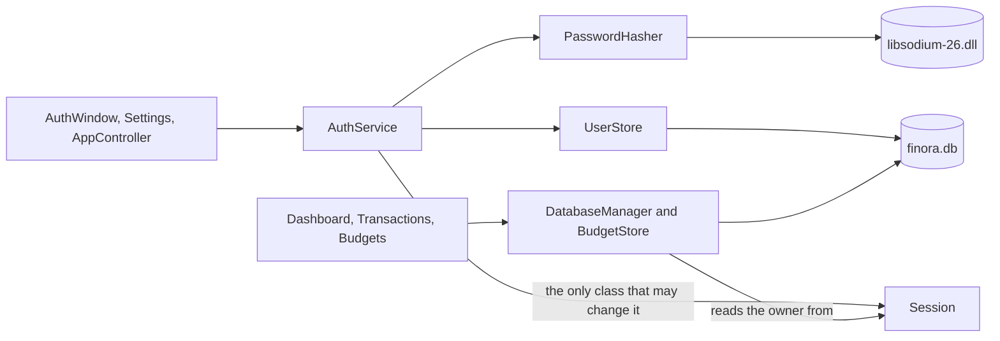

### 11.2 Start-up

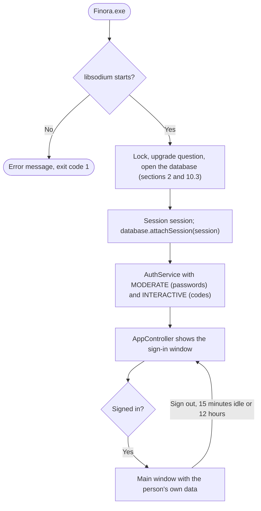

### 11.3 Signing in

```text
signIn(email, password):
    address = normalizeEmail(email)                     // trimmed, small letters
    find the account with this email
    IF there is none THEN
        IF this email already failed 3 times recently THEN wipe password; RETURN "Too many attempts..."
        verify the password against a dummy Argon2id hash   // the same work as a real account
        count one failure for this email (in memory); wipe password
        RETURN "The email or password is not correct."
    IF the account must still wait (locked_until in the future) THEN
        wipe password; RETURN "Too many attempts. Please wait N seconds and try again."
    IF NOT verify(stored hash, password) THEN
        failures = failures + 1; waiting time = signInDelaySeconds(failures)
        save both and an audit event; wipe password
        RETURN "The email or password is not correct."
    IF the stored hash uses older settings THEN replace it with a MODERATE hash
    wipe password; reset the failures; start a session row; session.start(...)
```

The two messages are word-for-word the same for a wrong password and an unknown email, and both get the same waiting times, so nobody can find out which emails have accounts.

### 11.4 Creating an account

```text
signUp(name, email, password):
    check name, email and password (PasswordPolicy); refuse an email that already has an account
    hash = Argon2id MODERATE(password)        // stop with a clear message if memory is missing
    wipe password
    make 10 random codes (randombytes_uniform); hash each with Argon2id INTERACTIVE
    ONE database transaction: the user row, the settings copied from this installation,
                              the 10 code hashes, the audit event
    start the session; return the 10 codes in plain text, to be shown ONCE
```

### 11.5 One person's data per account

```text
DatabaseManager::currentOwner(owner):
    IF no Session is attached THEN owner = NULL; RETURN true   // the tests of Milestones 2 to 4A
    IF nobody is signed in      THEN RETURN false: "Please sign in first."
    owner = session.userId(); RETURN true

every query:  ... WHERE ... AND user_id IS :owner
every insert: ... (user_id, ...) VALUES (:owner, ...)
```

- `IS` works for NULL and for numbers, so one SQL text serves both cases.
- Another person's record id behaves exactly like an id that does not exist: "not found".
- No function takes a user id from the screen. The id comes only from the `Session`, and only `AuthService`, after checking a password, can put an id into it.

### 11.6 Sessions

| Event | What happens | `login_sessions.end_reason` |
|---|---|---|
| Sign out (sidebar or Settings) | The session ends; the sign-in window says "You have signed out." | `signed_out` |
| 15 minutes without a key press or mouse action | `AppController` closes any open dialog, signs out, and explains why | `idle` |
| 12 hours after signing in | Checked once a minute while active | `expired` |
| Finora closes | `main()` ends the session after the event loop | `app_closed` |
| Finora crashed | The next start closes sessions left open | `interrupted` |
| Password reset with a code | All open sessions of the account end | `password_reset` |

### 11.7 Recovery codes

```text
resetPasswordWithRecoveryCode(email, code, newPassword):
    check newPassword against the policy (without the account, so nothing is revealed)
    find the account; unknown or waiting: the same work and the same general message
    FOR each UNUSED code hash of this account
        IF verify(code hash, code) THEN remember its id; stop
    none matched: count a failure; RETURN "The email or recovery code is not correct."
    ONE transaction: mark the code used (only if still unused), store the new password hash,
                     clear the failures, end the open sessions, write an audit event
```

### 11.8 Records made before accounts existed

They keep `user_id = NULL`, so no account sees them.

- Right after sign-up, Finora asks: "Move them into my account?" The default button is "Not now". Settings offers the same move later.
- `claimRecordsWithoutOwner` runs in one transaction:
  1. It moves the transactions and proves none is left behind.
  2. It moves the budgets, but keeps out any budget whose category and currency the account already has.
  3. It writes an audit event.

### 11.9 Security requirements and where they are met

| Requirement | How |
|---|---|
| Never store plaintext passwords | Only `crypto_pwhash_str` output is stored. A test searches every table, every column and the raw file bytes for the password: not found |
| Unique random salts | `crypto_pwhash_str` makes a new 16-byte salt for every hash; two accounts with the same password have different hashes (tested) |
| MODERATE settings, documented | `PasswordHasher(HASH_MODERATE)` in `main.cpp`; values and timings in `docs/MILESTONE4_PROGRESS.md` |
| Memory use tested, failures handled | Peak memory measured at about 265 MiB per hash and returned afterwards; a 512 GiB setting fails cleanly and no account is created (tested) |
| Recovery codes hashed | Argon2id INTERACTIVE; no code in plain text anywhere in the database (tested) |
| Short plaintext lifetime | Password boxes are emptied when read; every password parameter is a `std::string &` that `wipe()` overwrites with zeros |
| No user id from the interface | The owner comes only from the `Session`, which only `AuthService` can change (friend class) |
| Records belong to the signed-in person | `user_id IS :owner` in every transaction and budget query; isolation tested with two accounts |
| Existing records preserved | No new migration; older records move only with consent, in one verified transaction |

## 12. Milestone 4, Phase 4C: subscription plans and billing

Four plans: Finora Free ($0), Plus ($5.99), Pro ($12.99) and Business ($24.99) a month. These are proposed prices and have not been tested on the market. **Every payment is simulated:** Finora collects no card details, holds no payment-provider keys and moves no money.

### 12.1 Who does what

| Part | Layer | Job |
|---|---|---|
| `Plans` | core | `enum PlanId` (Free < Plus < Pro < Business), the plans as an array of structs, and **the one table of entitlements**: 28 features, each with its smallest plan and a state (built, planned or "needs Finora Online"). Also the budget limit and the "locked" messages |
| `Subscription` | core | `enum SubscriptionStatus` and the lifecycle as pure functions: `subscriptionAt`, `planAt`, `planChangeFor`, `canStartTrial` |
| `markPausedBudgets` | core | On Free, the 3 oldest budgets stay active and the others are paused |
| `CsvExport` | core | CSV text, with quoting and protection against formula injection |
| `DatabaseManager::currentPlan`, `requireFeature`, `budgetLimit`, `loadAuditHistory` | database | **The single gate.** Every protected operation calls it before it does anything |
| `SubscriptionStore` | database | All subscription and payment SQL, always for the Session's owner. Its changing functions are private; `SubscriptionService` is its only friend class |
| `PaymentGateway`, `SimulatedPaymentGateway` | billing | An abstract class and its one implementation, which moves no money |
| `SubscriptionService` | billing | Payments, plan changes, the trial, time, and the demonstration mode |
| `ReportExporter` | reports | The CSV export (Plus) and the monthly PDF summary (Pro, made with Qt's `QPdfWriter`) |
| `SubscriptionPage`, `CheckoutDialog`, `AuditHistoryDialog` | ui | The screens. They show locks and explanations, but never decide anything alone |

### 12.2 Schema version 3

Two new tables. No existing table, row or password hash is changed. Section 10.3 describes the upgrade itself: a verified backup, one transaction, and a rollback on failure.

- **`subscriptions`:** one row per account. It holds the plan and status; the start, renewal, end-of-access and cancellation times; a smaller plan waiting for the renewal date; whether the trial was used; and the last payment's reference and status.
- **`payments`:** the billing history, one row per attempt. Each row has the plan, the reason (new, upgrade or renewal), the amount in US cents, the status (pending, succeeded or failed), the provider (`simulated` only), a unique reference, the paid period and the failure reason.

The database's own rules (`CHECK`, `UNIQUE` and foreign keys):
- the plan and the status agree;
- an active plan has a renewal date, and every paid status has an end of access;
- there is one subscription per account;
- a payment is never for Free and never zero;
- a succeeded payment has its period;
- a payment and its subscription belong to the same account, enforced by a two-column foreign key on `(subscription_id, user_id)`.

There is **no column for card details** anywhere.

### 12.3 Plans and entitlements

Because the plans are an ordered enum, "Pro includes everything in Plus" is a single comparison:

```text
planIncludes(plan, feature) = plan >= FEATURES[feature].lowestPlan
requireFeature(feature):
    plan = currentPlan()                       // from the signed-in person's own row, deadlines applied
    IF the feature is not built OR NOT planIncludes(plan, feature) THEN
        RETURN false with "\"<feature>\" is part of <smallest plan>. Your plan: <plan>."
    RETURN true
currentPlan():
    no Session, nobody signed in, or the row missing or unreadable  ->  Free   (fails closed)
    otherwise  ->  planAt(row, now)
```

| Operation | Checked in |
|---|---|
| A new budget (Free: at most 3) | `BudgetStore::addBudget`, which every screen goes through |
| Which budgets are tracked | `BudgetStore::loadBudgets` marks the extra ones as paused |
| CSV export (Plus) | `ReportExporter::exportTransactionsCsv`, before any record is read |
| PDF summary (Pro) | `ReportExporter::exportMonthlyPdf`, before any record is read |
| Audit history (Business) | `DatabaseManager::loadAuditHistory` |
| Switching a paid plan on | `SubscriptionStore::activatePaidPlan`: only with a succeeded payment of the same person for the same plan |

The screens show a lock and an explanation ("See plans" or "Not now"), but they only save the person a wasted form. If a screen skipped its check, the operation itself would still refuse. The tests prove this by calling the stores and the exporter directly.

### 12.4 The subscription lifecycle

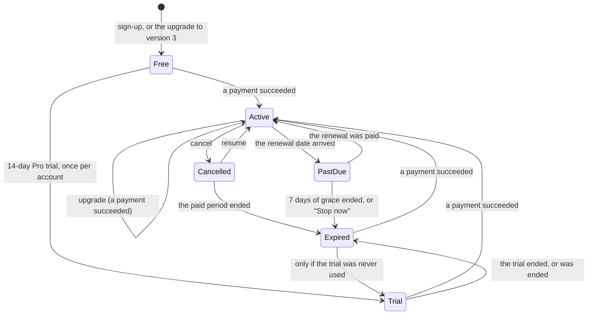

- **Time changes a subscription in two ways only** (`subscriptionAt`):
  - Active becomes Past due at the renewal date. A smaller plan chosen earlier starts then.
  - Trial, Past due and Cancelled become Expired, on Free, at their end of access.
- **Every time is stored as UTC text** such as `2026-11-30T10:00:00Z`. Written this way, text order is time order, so the rules compare times with `<`.
- **Renewal is confirmed by the person each month.** Finora stores no card, so nothing can honestly be charged automatically.

### 12.5 A payment, step by step

```text
payForPlan(plan, simulateDecline):
    current = subscriptionAt(stored row, now)            // deadlines applied and saved
    change  = planChangeFor(current, plan)
    IF change is not SUBSCRIBE, UPGRADE or RENEW THEN refuse ("needs no payment now")
    amount    = PLANS[plan].priceMinor                   // never from the screen
    reference = gateway.newReference()                   // "SIM-7KQ4M2TX9RHC"
    INSERT the payment as pending                        // a trace even if Finora crashes now
    result = gateway.charge(reference, amount, "USD")    // a virtual call
    IF NOT result.succeeded THEN
        payment -> failed, with the reason
        RETURN "The simulated payment was declined. ... Your plan has not changed."
    ONE transaction:
        payment      -> succeeded   WHERE id = payment AND user_id = owner AND plan = plan AND status = pending
        subscription -> active      WHERE user_id = owner
                                      AND EXISTS (a succeeded payment of this owner for this plan)
        audit event "plan_activated"
    (if either UPDATE changes no row, everything is rolled back and the payment is marked as failed)
```

At start-up, a payment left `pending` by a crash is marked as failed. Only one copy of Finora can run, so no other copy can be in the middle of a payment.

### 12.6 Budgets on Free

```text
markPausedBudgets(budgets, limit):
    FOR each budget b
        older = the number of budgets with a smaller id than b
        b.paused = (limit is not UNLIMITED) AND (older >= limit)
```

Paused budgets are kept, shown and can be edited or deleted, but they are not tracked: they cause no alerts and are left out of the totals.

- **One rule covers every way to exceed the limit:** a downgrade, a trial or paid period that ends, and moving older records into an account.
- **Upgrading makes every budget active again.**
- **Without a Session there is no limit.** That mode has no accounts and so no plans; only the tests of Milestones 2 to 4A run like this.

### 12.7 Exports and the audit history

- **CSV (Plus).** `transactionsCsv()` writes the header `Date,Type,Category,Description,Currency,Amount` and one line per transaction, each ending with `\r\n`. Amounts are written as `1200.50`, without thousands separators.
  - A field with a comma, a quote or a line break is put in quotes, and inner quotes are doubled.
  - A field that starts with `=`, `+`, `-`, `@`, a tab or a carriage return gets a `'` in front, so a spreadsheet never runs it as a formula ("CSV injection").
  - `QSaveFile` writes the file atomically: the real file is replaced only when everything was written. The file starts with the UTF-8 mark so Excel reads it correctly.
- **PDF (Pro).** `monthlySummaryHtml()` builds a simple page: income and expenses per currency (never mixed), spending by category, and the tracked budgets.
  - Text from the records is escaped (`toHtmlEscaped`), so a category such as `<b>` cannot change the page.
  - `QTextDocument::print()` draws the page onto a `QPdfWriter` with A4 pages. Both are part of Qt GUI, so no new library is needed.
- **Audit history (Business).** The signed-in person's own `audit_events`, newest first: sign-ins, password changes, plan changes, payments and exports.

### 12.8 Security requirements and where they are met

| Requirement | How |
|---|---|
| Never store real card information | No card field in `PaymentRequest`, in the checkout or in the tables. Tests check that the checkout has no text field and that no column name suggests card data |
| Never claim that a simulated payment is real | A banner on the Subscription page and in the checkout; the provider can only be `simulated` (`CHECK`); the history says "Paid (simulated)" |
| No paid plan without a successful payment of the same person and plan | The guard in `activatePaidPlan` (12.5). A test gateway that tampers with the payment in three ways cannot switch on a plan |
| Subscription and payment operations tied to the Session | The owner comes only from the Session through `DatabaseManager`; no function takes a user id from the screen; `SubscriptionService` is the only friend of `SubscriptionStore` |
| Nothing deleted on a downgrade | Budgets are paused, not deleted (tests count the rows); expired plans keep every record |
| No payment-provider secrets in the application | The simulated gateway has no keys and no network code. A search of the code found none |
| Plan rules below the screens | `BudgetStore`, `ReportExporter` and `loadAuditHistory` check by themselves |
| The demonstration mode cannot be used otherwise | `SubscriptionService::simulatePeriodEnd` refuses unless Finora was started with `--billing-demo` |
| One person's subscription data | Every query has `user_id = :owner`; two-column foreign key; tests with two accounts |

### 12.9 A real payment provider: the production path (Planned — Not Yet Implemented)

1. **The desktop app never sees card details or provider keys.**
   - It asks Finora's server to start a checkout.
   - The server creates a checkout session at the provider with its **secret key**, which exists only on the server, and returns a link to the provider's hosted payment page.
   - The app opens that link in the browser.
2. **The provider confirms the payment to the server.** It charges the customer and calls the server's webhook. The server:
   - verifies the webhook's **signature** with a second server-only secret;
   - records the event **idempotently**, so the same event arriving twice changes nothing;
   - updates the subscription.
3. **The app reads its plan from the server** (a signed entitlement), not from the local SQLite file. Editing the local file then unlocks nothing.
4. **Renewals are charged by the provider,** which keeps the payment method. A failed renewal leads to Past due with the same grace period.
5. **In Finora's code**, a new `PaymentGateway` subclass that talks to the server replaces `SimulatedPaymentGateway`. `SubscriptionService` stays the same, and the provider rule in `payments` gets a migration.

### 12.10 Payment providers usable from Pakistan (research note)

Checked on 31 October 2026, on the providers' own pages where they could be read. Conditions change: confirm with each provider, and with a lawyer and an accountant (company registration, FBR tax, State Bank of Pakistan rules), before signing anything.

Each row separates what an official source **confirms** from what still **needs the provider's own confirmation**. Nothing here confirms that a particular Pakistani seller will be accepted; every provider checks each seller itself.

| Option | What it is | Confirmed by an official source | Still needs direct confirmation | Source |
|---|---|---|---|---|
| Stripe | Card payments and subscriptions | Pakistan is **not** on Stripe's list of countries where businesses can sign up. A Pakistani business cannot open its own Stripe account; only a company registered in a supported country can | Nothing; this row is a confirmed "no" for a company registered in Pakistan | [stripe.com/global](https://stripe.com/global) |
| Paddle | A "merchant of record": it sells the software on the seller's behalf and handles sales tax and VAT, invoices and refunds | Pakistan is **not** on Paddle's list of unsupported countries, and Paddle says it works with software businesses anywhere except those countries | Whether Paddle accepts a particular seller from Pakistan: Paddle verifies every seller, its list can change, and the page does not mention individual sellers | [Paddle: supported countries](https://www.paddle.com/help/start/account-verification/which-countries-are-supported-by-paddle), [developer documentation](https://developer.paddle.com/concepts/sell/supported-countries-locales) |
| Safepay | A Pakistani payment gateway | Its own site lists subscriptions ("recurring payments"), tokenization (Vault), developer APIs, and local methods including Raast, Easypaisa, JazzCash and PayPak. It calls itself a regulated payment system operator and provider | Merchant eligibility, prices, which methods allow automatic renewals, and the regulator and licence behind "regulated" (the page does not name them) | [getsafepay.pk](https://getsafepay.pk/) |
| Easypaisa Online Payment Gateway | The merchant gateway of Easypaisa | Its business page describes the gateway: open to businesses with a live website or app; registration and identity checks through a merchant portal; settlement daily or instantly for mobile-account payments, and in 7 working days for over-the-counter payments. The page itself blocked automated reading, so these points come from its indexed text | Whether recurring or subscription payments are possible (the page does not describe them), prices and the current terms | [easypaisa.com.pk](https://easypaisa.com.pk/?p=16718) |
| JazzCash | A mobile-wallet payment gateway | Nothing: the official site refused an automated reading. Only third-party sources describe a hosted checkout for registered merchants | Everything: eligibility, the integration, recurring payments, prices | [jazzcash.com.pk](https://www.jazzcash.com.pk) |
| PayFast | The gateway of APPS (Avanza Premier Payment Services) | Nothing from PayFast itself: the official site refused an automated reading. A news report says the State Bank of Pakistan approved its pilot operation in 2020 | Everything: its current licence, eligibility, recurring payments, prices | [gopayfast.com](https://gopayfast.com), [ProPakistani, 2020](https://propakistani.pk/2020/07/17/state-bank-of-pakistan-grants-approval-for-pilot-operation-to-apps-for-ecommerce-payment-gateway-payfast/) |
| Raast | Pakistan's instant payment system, run by the State Bank | The State Bank announced person-to-merchant (P2M) payments in December 2023 | Which bank or provider would connect Finora to Raast, and on what terms. Raast is not a card-subscription system by itself, but it suits a monthly "pay now" renewal like Finora's | [SBP press release, 6 Dec 2023](https://www.sbp.org.pk/press/2023/Pr-06-Dec-2023.pdf) |

**A possible plan for Finora Online:**
- a merchant of record such as Paddle for customers abroad;
- a local gateway with subscriptions (such as Safepay) or the wallets and Raast for customers paying in PKR;
- in both cases, through Finora's own server as in 12.9.

### 12.11 Limitations of Phase 4C

- **Payments are simulated,** and each renewal is confirmed by the person.
- **Plans are enforced on this computer.** Whoever owns it can edit `finora.db` or set the Windows clock back. Real enforcement needs the server of 12.9.
- **An upgrade starts a new month at the full price,** without a refund for the unused part. The checkout says so.
- **Some features are not built yet.** Many are marked "Soon", and Business team features are marked "Online" (they need Finora Online). The page never shows a tick for them.
- **Exported files are not encrypted.**
