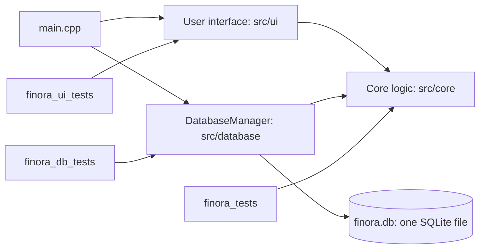
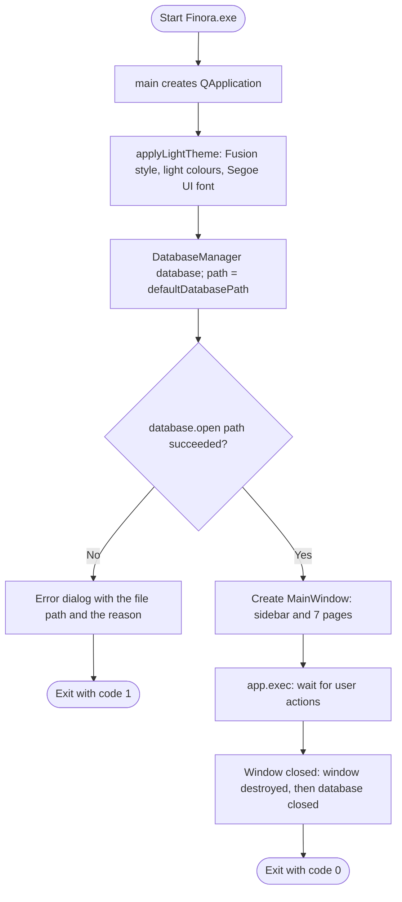

# Finora Design

This document explains how Finora is organised and how its algorithms work. It describes only what exists in the code. Anything not built yet is marked **Planned — Not Yet Implemented**.

Last updated: Milestone 2, 28 October 2026.

## 1. Architecture

Finora is split into layers. Each layer has one job.

| Layer | Folder | Job | Uses Qt? | Status |
|---|---|---|---|---|
| Core logic | `src/core` | Rules in plain C++: greeting, transaction validation, dates, currencies | No | Done for Milestones 1 and 2 |
| Database | `src/database` | Open the SQLite file, create tables, save and read transactions | Yes, Qt SQL | Done for Milestone 2 |
| User interface | `src/ui` | Window, sidebar, pages, theme | Yes, Qt Widgets | Navigation shell done |
| Tests | `tests` | Check the core, the window and the database automatically | Core tests no; the others yes | 3 test programs |



**Why the core has no Qt.** Rules such as "the amount must be above zero" live in `src/core` and use only standard C++: `int`, `long long`, `std::string`, arrays and structures. A small console program can test them directly.

**Why all SQL is in one class.** `DatabaseManager` is the only code that contains SQL. In `CMakeLists.txt`, Qt SQL is linked to `finora_database` as `PRIVATE`, so the user interface cannot even see the SQL classes. If the database ever changes, only one class changes.

## 2. Program start-up



Pseudocode for `main()` in `src/main.cpp`:

```text
CREATE the Qt application and set its name and version
CALL applyLightTheme(application)
CREATE a DatabaseManager called database
path = DatabaseManager::defaultDatabasePath()
IF NOT database.open(path) THEN
    SHOW an error dialog with path and database.lastError()
    RETURN 1                         // Finora never runs without saving
END IF
CREATE and SHOW the main window
RUN the event loop until the window is closed
RETURN the exit code                 // database closes automatically (RAII)
```

`database` is declared before `window`. C++ destroys local objects in the reverse order, so the window is destroyed first and the database is closed last.

## 3. Page navigation

When the user clicks a sidebar button, three functions run one after another.


```text
IF pageNumber < 0 OR pageNumber >= PAGE_COUNT THEN
    RETURN                      // invalid number: do nothing
END IF
SHOW page number pageNumber in the page stack
HIGHLIGHT sidebar button number pageNumber
```

## 4. Greeting algorithm

`greetingForHour(int hour)` in `src/core/Greeting.cpp` chooses the dashboard title.

```text
FUNCTION greetingForHour(hour)
    IF hour < 0 OR hour > 23 THEN RETURN "Hello"          // invalid input
    IF hour >= 5 AND hour < 12 THEN RETURN "Good Morning"
    ELSE IF hour >= 12 AND hour < 17 THEN RETURN "Good Afternoon"
    ELSE RETURN "Good Evening"                             // 17 to 23 and 0 to 4
END FUNCTION
```


## 5. Starting window size

`MainWindow::setStartingSize()` opens the window at 1280 × 800 pixels, but never larger than 90% of the screen area above the taskbar, and centres it.

```text
width = 1280, height = 800
maxWidth  = screenWidth  * 9 / 10
maxHeight = screenHeight * 9 / 10
IF width  > maxWidth  THEN width  = maxWidth
IF height > maxHeight THEN height = maxHeight
left = screenLeft + (screenWidth  - width)  / 2
top  = screenTop  + (screenHeight - height) / 2
```

Example: a screen area of 1366 × 728 gives `maxHeight = 728 * 9 / 10 = 655` with integer division, so the window opens at 1229 × 655.

## 6. Money rules

**Implemented in Milestone 2:**

1. PKR, USD and EUR all use two decimal places. The `decimal_places` column of the `currencies` table records this.
2. Each amount is stored as a whole number of the smallest unit, paisa or cents. In C++ it is a `long long`; in SQLite it is an `INTEGER`, which is also 64-bit. Example: PKR 1,200.50 is stored as `120050`. Whole numbers add up exactly, unlike `double`.
3. One transaction must have an amount above 0 and at most `MAX_AMOUNT_MINOR = 999,999,999,999` minor units, which is 9,999,999,999.99. This is a validation rule for a single transaction. That maximum fits easily in a signed 64-bit integer, whose limit is 9,223,372,036,854,775,807.
4. Zero and negative amounts are rejected. The transaction type, income or expense, gives the direction of the money.
5. Currency codes are exact, upper-case ISO codes. `"pkr"` is rejected.

**Rule for future totals — Planned — Not Yet Implemented (Milestone 4).** The single-transaction limit does not make totals safe. Adding enough amounts together could pass the 64-bit limit and silently wrap around to a wrong, even negative, number. Every total must therefore use checked addition:

```text
FUNCTION addChecked(total, amount)
    IF amount > LONG_LONG_MAX - total THEN
        REPORT "Total is too large"          // never overflow silently
    ELSE
        total = total + amount
    END IF
END FUNCTION
```

**Planned — Not Yet Implemented:**

6. A typed amount with more than two decimals will be rejected, not rounded (Milestone 3, when amounts are typed in a form).
7. Exchange rates will be stored to four decimal places, and a conversion will round once to the nearest paisa or cent, with halves rounding up (Milestone 5).
8. Totals will always be shown per currency. A converted total will be labelled as converted and show the rate used (Milestones 4 and 5).

## 7. Database

### 7.1 Location

| | |
|---|---|
| File | `%LOCALAPPDATA%\Finora\finora.db` |
| Full form | `C:\Users\<user name>\AppData\Local\Finora\finora.db` |
| Chosen by | `DatabaseManager::defaultDatabasePath()`, using Qt's `QStandardPaths::AppLocalDataLocation` and the application name "Finora" |
| Created | Automatically at the first start, folder and file |

The file is not in the program folder, because programs installed under `C:\Program Files` cannot write there, and it is not in the source folder, because Git must never upload personal data. `.gitignore` already ignores `*.db` files.

### 7.2 Schema version 1

**Table `currencies`:** the currencies Finora supports. It is filled at creation from the `SUPPORTED_CURRENCIES` array in `src/core/Transaction.h`.

| Column | Type and rule | Purpose |
|---|---|---|
| `code` | `TEXT PRIMARY KEY`, exactly 3 characters | ISO code: PKR, USD, EUR. The primary key makes every code unique |
| `name` | `TEXT NOT NULL` | Pakistani Rupee, US Dollar, Euro |
| `symbol` | `TEXT NOT NULL` | Rs, $, € |
| `decimal_places` | `INTEGER NOT NULL`, 0 to 3 | Digits after the decimal point: 2 for all three |

**Table `transactions`:** one row per income or expense.

| Column | Type and rule | Purpose |
|---|---|---|
| `id` | `INTEGER PRIMARY KEY AUTOINCREMENT` | Unique record number. AUTOINCREMENT means a number is never reused, even after a record is deleted |
| `type` | `TEXT NOT NULL`, `'income'` or `'expense'` | Direction of the money |
| `amount_minor` | `INTEGER NOT NULL`, 1 to 999999999999 | Amount in paisa or cents |
| `currency_code` | `TEXT NOT NULL REFERENCES currencies (code)` | Foreign key: the currency must exist in `currencies` |
| `category` | `TEXT NOT NULL`, not blank | For example Food or Salary |
| `description` | `TEXT NOT NULL DEFAULT ''` | Optional note |
| `transaction_date` | `TEXT NOT NULL`, must be a real date | ISO format `YYYY-MM-DD`, which sorts correctly as text and is understood by SQLite's date functions |

**Budgets** are not in version 1. They will be added in Milestone 4 as schema version 2. **Planned — Not Yet Implemented.**

### 7.3 Two lines of defence

1. **C++ validation.** `validateTransaction()` in `src/core/Transaction.cpp` checks every field before any SQL runs, and gives a clear message such as "Amount must be greater than zero."
2. **SQLite rules.** `CHECK` constraints and the `FOREIGN KEY` repeat the important rules inside the database, so even SQL typed by hand cannot store a zero amount, an unknown currency or a date like 2026-02-30. SQLite enforces foreign keys only after `PRAGMA foreign_keys = ON`, which `enableForeignKeys()` runs at every open and then checks.

### 7.4 Schema versioning

SQLite keeps a whole number called `user_version` inside every database file, for the program's own use. Finora uses it as the schema version. The constant `CURRENT_SCHEMA_VERSION` in `DatabaseManager.h` is 1.

| `user_version` in the file | Meaning | What `upgradeSchema()` does |
|---|---|---|
| 0 | New, empty file | Creates the version 1 tables and currencies, then sets `user_version = 1`, all inside one database transaction |
| 1 | Up to date | Nothing |
| 2 or more | Made by a newer Finora | Refuses to open and leaves the file unchanged |

Inside the transaction, either every step is saved by `commit()`, or `rollback()` undoes all of them, so a half-created database cannot exist. The statements also use `CREATE TABLE IF NOT EXISTS` and `INSERT OR IGNORE`, so repeating them can never create duplicates. In Milestone 4, version 2 will add one more step: "if the version is below 2, create the budgets table".

### 7.5 Opening the database


### 7.6 Connection and query lifetime (RAII)

- One `DatabaseManager` object owns one named Qt SQL connection. `open()` creates it. `close()` and the destructor remove it, so the connection can never outlive its owner. This idea is called RAII: resource acquisition is initialisation.
- Copying a `DatabaseManager` is disabled with `= delete`. A copy would share the connection name, and destroying the copy would close the original's connection.
- `close()` removes a connection only if this object opened it. A second object that was refused a duplicate name therefore cannot disturb the first.
- The class never stores `QSqlDatabase` or `QSqlQuery` objects as members. Each function creates them as local variables, which are destroyed when the function returns. In `open()` and `close()`, extra braces `{ ... }` end the life of the handle before `QSqlDatabase::removeDatabase()` runs. Qt prints the warning "connection is still in use" if this order is wrong. The database tests print no such warning.

### 7.7 Saving and reading a transaction

`addTransaction(Transaction &transaction)`:

```text
IF the database is not open THEN fail "The database is not open."
problem = validateTransaction(transaction)
IF problem is not empty THEN fail with problem          // no SQL runs
PREPARE "INSERT INTO transactions (...) VALUES (:type, :amount, ...)"
BIND each placeholder to a field of the transaction
EXECUTE; IF it fails THEN fail "Could not save the transaction: <SQLite message>"
transaction.id = the id SQLite gave the new row
RETURN true
```

`findTransactionById(int id, Transaction &result)` checks `id > 0`, runs a prepared `SELECT ... WHERE id = :id`, and returns "No transaction with id N was found." when there is no such row. Otherwise it copies each column into `result`.

**Prepared statements.** The SQL text contains only placeholders such as `:description`, and the values are sent separately. A description like `Ali's café; DROP TABLE transactions; --` is therefore stored as plain text and can never change the command. This prevents SQL injection, and the database tests prove it.

### 7.8 Inspecting, backing up and resetting

- **Open the folder:** press Win + R, type `%LOCALAPPDATA%\Finora` and press Enter.
- **Look inside:** close Finora and open `finora.db` in any SQLite viewer, such as the free DB Browser for SQLite.
- **Back up:** close Finora, then copy `finora.db` to a safe place.
- **Restore:** close Finora, then copy the backup over `finora.db`.
- **Start empty:** close Finora and delete `finora.db`. A new empty database is created at the next start. This permanently deletes all records.

### 7.9 Two copies of Finora at the same time

Before the single-instance guard below existed, nothing stopped a second copy of Finora from opening the same database. SQLite lets several programs read the file, but only one can write at a time. A program that wants to write while another holds the write lock must wait, and Qt's SQLite driver gives up after a timeout.

Measured on 28 October 2026 with temporary databases and Finora's real `DatabaseManager`:

| Test | Result |
|---|---|
| Two programs each saving 300 transactions at the same moment | 591 saved and 9 rejected with "database is locked"; saves slowed to several seconds each; integrity check ok |
| One save while another program held the write lock for 3 seconds | Waited about 2.3 seconds, then saved |
| One save while another program held the write lock for 8 seconds | Rejected after about 6 seconds with "database is locked" |
| Two programs creating the same new database at the same moment, 20 times | No failures |

A rejected save is not stored: `addTransaction` returns `false` and `lastError()` holds the reason. No test damaged a database, but these tests do not prove that every way of using two copies is safe.

**Single-instance guard (done, first task of Milestone 3).** `src/database/InstanceLock.h/.cpp` wraps Qt's `QLockFile`. Before opening the database, `main()` locks a file named `finora.lock` in the same folder as `finora.db`:

```text
lock = InstanceLock(folder of finora.db + "/finora.lock")
IF lock.tryLock() fails THEN
    IF another copy holds it THEN show "Finora is already open"
    ELSE show the database error dialog with the reason
    EXIT with code 1
open the database, show the window ...
```

- `tryLock(0)` tries once and does not wait, so a second copy closes at once instead of hanging.
- `setStaleLockTime(0)` switches off Qt's default rule that a lock older than 30 seconds is abandoned. Without it, a second copy started 30 seconds after the first would take the lock away from a Finora that is still open.
- A lock left behind by a crash is still taken over, because `QLockFile` writes the program's process number into the file and checks whether that program is still running.
- `instanceLock` is declared before `database` in `main()`, so C++ destroys it after the database is closed: the lock is never released while the database is still open (RAII).
- The data folder is per Windows user, so the guard stops two copies for the same user. Two different users have separate databases and do not block each other.

SQLite's journal mode stays at its default, and no retry framework is added. `finora_db_tests` checks the guard: a second lock on the same file is refused with "already running", the file disappears when the first lock is released, a lock from a program that is no longer running is taken over, and a lock file that cannot be created is reported as an error, not as "already running".

## 8. Validation algorithms

All in `src/core/Transaction.cpp`.

**Leap years.** `isLeapYear(year)`:

```text
IF year % 400 == 0 THEN RETURN true      // 2000 was a leap year
IF year % 100 == 0 THEN RETURN false     // 1900 and 2100 are not
RETURN year % 4 == 0                     // 2024 is, 2026 is not
```

**Days in a month.** `daysInMonth(year, month)` uses a `switch`: months 1, 3, 5, 7, 8, 10 and 12 have 31 days; 4, 6, 9 and 11 have 30; February has 29 in a leap year and 28 otherwise; any other number returns 0.

**Real calendar dates.** `isValidIsoDate(text)`:

```text
IF length is not 10 OR text[4] is not '-' OR text[7] is not '-' THEN RETURN false
FOR each other position: IF the character is not '0'..'9' THEN RETURN false
year = digits 0-3, month = digits 5-6, day = digits 8-9      // each digit: character - '0'
IF year < 1900 OR year > 2100 THEN RETURN false              // catches typing mistakes
IF month < 1 OR month > 12 THEN RETURN false
IF day < 1 OR day > daysInMonth(year, month) THEN RETURN false
RETURN true
```

Example: `"2026-02-29"` passes the shape and digit checks, gives year 2026, month 2 and day 29. `daysInMonth(2026, 2)` is 28 because 2026 is not a leap year, and 29 > 28, so the date is rejected.

**Whole transaction.** `validateTransaction()` checks, in this order: type, amount above 0, amount at most the maximum, supported currency, non-blank category, real date. It returns the message for the first problem, or an empty string when everything is valid.
