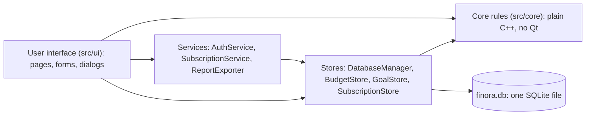

# Finora: Technical Notes for the Presentation

The facts behind each slide of the university presentation, taken from the code and the test results. Every statement here describes what Finora really does on 31 October 2026. Anything simulated or planned is labelled as such.

## 1. Why Finora was developed

- **The problem.** Many students and young professionals in Pakistan earn, spend and save in more than one currency: PKR at home, USD for freelance income, EUR for online courses. Simple expense apps add these numbers together as if they were the same money, or they need an online account and an internet connection. Spreadsheets give no protection against mistakes: a typo, a wrong formula or a deleted row silently changes the totals.
- **What Finora does.** It is an offline Windows program that records income and expenses, compares spending with monthly budgets, tracks savings goals and reports on any month or year, while keeping every currency separate unless the person asks for a clearly labelled estimate.
- **Target users.** Students and young professionals who manage their own money; freelancers paid in USD or EUR; small households. The Business plan is aimed at small businesses, but its team features need Finora Online (planned).
- **Course context.** An individual semester project for Programming Fundamentals (SW112, MUET). It shows that fundamentals (variables, loops, functions, arrays, structures, files) and object-oriented programming can build a careful, real-world product.

## 2. Main features and workflows

| Workflow | What the person does | Where in the code |
|---|---|---|
| Accounts | Create an account, sign in and out, change the password, reset it with a recovery code | `AuthService`, `AuthWindow` |
| Transactions | Add, edit, delete, search and filter income and expenses | `TransactionsPage`, `DatabaseManager` |
| Dashboard | One wallet card per currency, a money-flow chart, spending by category, budget alerts | `DashboardPage`, `Totals` |
| Budgets | A monthly limit per category and currency; warnings at 80% and 100% | `BudgetsPage`, `Budget`, `BudgetStore` |
| Savings goals (Plus) | A target and an optional date, money in and out, progress, the amount to save each month | `GoalsPage`, `Goal`, `GoalStore` |
| Currency | Rates typed by the person, a converter, all balances as one estimate | `CurrencyPage`, `ExchangeRates` |
| Reports (Plus) | Any month or year, one currency: income, expenses, net, the change from the period before, categories, month by month, a CSV file | `ReportsPage`, `Reports`, `ReportExporter` |
| Subscription | Compare four plans, a simulated checkout, a billing history, cancel and resume, a 14-day Pro trial | `SubscriptionPage`, `SubscriptionService` |
| Exports | All transactions as CSV (Plus), a monthly PDF summary (Pro), the audit history (Business) | `ReportExporter`, `AuditHistoryDialog` |
| Settings | Light or dark theme, reduce motion, profile, security, where the data is kept | `SettingsPage`, `Theme` |

## 3. Why C++17 and Qt 6

- **C++17** is the language of the course, and it is fast, compiled to a native Windows program, and gives full control over memory and data types. Finora uses only standard features that are taught: classes, structures, enums, vectors, references, `const`, RAII. `long long` holds money exactly as whole paisa.
- **Qt 6 Widgets** is named in the project brief as a suitable GUI library. It is a mature, cross-platform C++ toolkit: windows and forms (Widgets), drawing (`QPainter` for Finora's own chart), SQL access to SQLite (Qt SQL), PDF writing (`QPdfWriter`) and SVG icons (Qt Svg). Using Qt means no other GUI or chart library was needed.
- **MinGW 13.1, CMake and Ninja** build it. CMake describes the program, the five libraries and the five test programs in one file.

## 4. Why SQLite

- A whole database in **one file** (`%LOCALAPPDATA%\Finora\finora.db`), with no server to install. Perfect for an offline, single-person desktop program.
- **Transactions** (all-or-nothing changes), **CHECK rules**, **foreign keys**, **UNIQUE** indexes and a **trigger** protect the data even from SQL typed by hand.
- Easy to **back up** (copy one file) and to inspect (DB Browser for SQLite).
- Finora uses **prepared statements** everywhere, so text such as `O'Brien` or `'; DROP TABLE` can never change a command (no SQL injection).
- The **schema has a version** (`PRAGMA user_version`, now 4). An older file is upgraded only after the person agrees, with a verified backup first and one transaction that is rolled back on any failure; even a power cut in the middle is safe.

## 5. Architecture

- **Core (`src/core`)** holds every rule in plain C++: validation, money, dates, totals, budgets, goals, rates, plans, reports, CSV text. It knows nothing about windows or SQL, so a console test program checks it directly.
- **Database (`src/database`)** holds **all** the SQL. Qt SQL is linked `PRIVATE`, so the pages cannot even see SQL classes.
- **Services** add the business processes: `AuthService` (accounts, libsodium), `SubscriptionService` (plans and simulated payments), `ReportExporter` (reports and files).
- **User interface (`src/ui`)** shows data and sends the person's actions on. Every page inherits from `Page` and overrides `refresh()`; `MainWindow` keeps them as `Page *` (polymorphism).

**How the parts talk, for one action ("Add money" to a goal):**
1. The button's `clicked` **signal** calls the page's **slot** (Qt signals and slots).
2. The form reads the amount with `parseAmount` (core) and checks `validateContribution` (core).
3. `GoalsPage` calls `GoalStore::addContribution` (database layer).
4. The store checks the plan (`requireFeature`), takes the owner from the `Session`, and in **one database transaction** reads the saved amount, checks the rules again and inserts the row; SQLite's trigger checks once more.
5. The page calls `refresh()`, which reloads and redraws, and a toast confirms.

## 6. Authentication and password hashing

- **Passwords are never stored.** Finora stores an **Argon2id hash** made by **libsodium** (a well-known, audited cryptography library): MODERATE settings, 256 MiB of memory and 3 passes, about 0.65 s per hash, with a random salt per password. The stored text looks like `$argon2id$v=19$m=262144,t=3,p=1$<salt>$<hash>`.
- **Signing in** recomputes the hash and compares it. Wrong email and wrong password give the **same message**, and an unknown email still costs one hash, so nobody can learn which accounts exist. After 3 wrong passwords, Finora asks the person to wait a little longer each time.
- **Recovery codes:** 10 single-use codes, shown once and stored only as hashes.
- **Sessions** end after signing out, after 15 minutes without activity, and after 12 hours.
- **One person's data per account:** every query says `user_id IS :owner`, and the owner comes only from the `Session`, which only `AuthService` (a **friend class**) can change.
- **Honest scope:** these are **local accounts** on one computer. There is no server, no email and no online sign-in.

## 7. Multi-currency calculations

- **Money is a whole number of minor units** (`long long`): 1,200.50 is stored as 120050. No `double` is ever used for money, so there are no binary rounding errors.
- **Every total belongs to one currency.** PKR, USD and EUR are never added together on the dashboard, in budgets, goals or reports. Every addition is **checked**: before adding, Finora tests `total > LLONG_MAX - amount`, so a total can never wrap around.
- **Exchange rates are typed by the person** (Finora never downloads them) with 4 decimal places, stored as whole numbers: 278.5 is `2785000`.
- **Conversion:** `result = amount x rate(from) / rate(to)`, through PKR, rounded once to the nearest paisa or cent, an exact half **away from zero**: `(2 x product + rate(to)) / (2 x rate(to))`. A **checked multiplication** refuses numbers that would not fit.
- **Verification:** 200,095 conversions matched an independent exact calculation, with 0 differences.
- The Currency page's "all your balances in one currency" is labelled as an **estimate**; records are never converted.

## 8. Subscription plans and feature entitlements

| Plan | Price a month (proposed) | For whom | Built now |
|---|---|---|---|
| Finora Free | $0 | Anyone starting out | Transactions, dashboard, PKR/USD/EUR, up to 3 active budgets, alerts, exchange rates |
| Finora Plus | $5.99 | Individuals who plan ahead | Unlimited budgets, savings goals, monthly and yearly reports, CSV exports |
| Finora Pro | $12.99 | Power users | A monthly PDF summary (more analytics are planned) |
| Finora Business | $24.99 | Small businesses | The audit history (team features need Finora Online) |

- **Why four plans:** a free plan lets everyone use the core of personal finance; each paid plan adds value for a clearly different need (planning, deeper analysis, business accountability). It also lets the course demonstrate an ordered `enum` and a single table of entitlements.
- **One table of entitlements** (`FEATURES` in `Plans.h`): each feature has its smallest plan and a state (built, planned, or needing Finora Online). Because `PlanId` is an ordered `enum`, "Pro includes Plus" is one comparison: `plan >= lowestPlan`.
- **Checked below the screens.** `requireFeature()` is called inside `BudgetStore`, `GoalStore`, `ReportExporter` and `loadAuditHistory`, before any record is read. Screens show locks and "See plans", but even a screen that forgot would be refused. If the plan cannot be read, Finora **fails closed** to Free.
- **Downgrades never delete data.** Extra budgets are paused; goals stay visible and can be deleted, but not changed.

## 9. Implemented, simulated and future

| Implemented and working | Simulated (clearly labelled in the program) | Future: needs Finora Online or more work |
|---|---|---|
| Local accounts with Argon2id, recovery codes, sessions | Payments: the checkout says "Simulated payment"; no card details are collected and no money moves | Real online payments through a provider such as Paddle or a Pakistani gateway, with a server and verified webhooks |
| Transactions, dashboard, budgets, goals, rates, reports | The `--billing-demo` button that ends a billing period at once, for demonstrations | Cloud synchronisation and online sign-in |
| Plans and entitlements enforced in the service layer | | Business team members, shared workspaces and roles |
| CSV exports, the monthly PDF summary, the audit history | | Recurring transactions, advanced filters and analytics, custom categories, net worth, a financial calendar |
| Safe database upgrades with verified backups | | Automatically downloaded exchange rates |

## 10. C++ concepts demonstrated

See `docs/CPP_CONCEPTS_MAP.md` for every concept with its file. The highlights:
- **Fundamentals:** variables, constants, `long long` money, operators including `%` (leap years), `if / else`, `switch` (days per month, the subscription state machine), `for` and `while` loops, functions, arrays of structs (`PLANS`, `FEATURES`, `NAV_ITEMS`), `std::vector`, `std::string`, file handling.
- **OOP:** classes with private data and public functions (encapsulation), constructors and constructor overloading, a destructor and RAII (`DatabaseManager`, `InstanceLock`), copying disabled, **inheritance** (every page from `Page`), **polymorphism** (`virtual void refresh()`, `paintEvent`), an **abstract class** (`PaymentGateway`), **composition** (`GoalsPage` has a `GoalStore`), **friend classes** (`AuthService`, `SubscriptionService`), `enum` types.
- **Algorithms:** checked addition and multiplication, ceiling division, rounding half away from zero with integers, date validation, sorting with a comparison function, totals by month and category.

## 11. Testing methodology and results

- **Five automated test programs**, built by CMake and run by CTest: core rules (no Qt), the database on real SQLite files in temporary folders, the interface (the real windows drawn off-screen, buttons clicked from code), accounts and security, and plans, billing, goals and reports.
- **Every test prints PASS or FAIL** and the program returns 1 if anything failed. The tests never touch the real data file.
- **Results on 31 October 2026:** see the table in `README.md` and `docs/MILESTONE6_7_PROGRESS.md` (more than 1,200 checks in each of the debug and release builds, 0 failed; CTest 5 of 5; no compiler warnings).
- **Beyond the test programs:** the database upgrade was run on copies of a real data file in five scenarios (103 checks), including a simulated power cut; 200,095 conversions were compared with an independent calculation; the packaged program was checked for missing DLLs and run with only Windows on the PATH.

## 12. A possible slide outline

1. Title: Finora, Your Money. Your Control.
2. The problem and the target users (section 1).
3. Features at a glance (section 2), with screenshots.
4. Technology: C++17, Qt 6, SQLite, libsodium (sections 3 and 4).
5. Architecture and how the layers talk (section 5).
6. Security: Argon2id, sessions, one person's data (section 6).
7. Money done right: minor units, checked arithmetic, currencies never mixed (section 7).
8. Plans and entitlements (section 8).
9. Implemented, simulated, future (section 9).
10. C++ and OOP concepts (section 10).
11. Testing and results (section 11).
12. Live demonstration (`docs/DEMO_FINAL.md`).
13. Questions.
